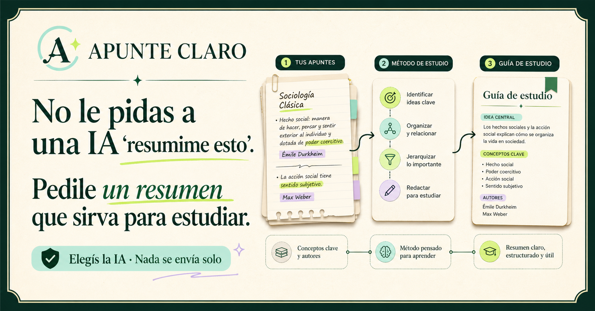

# Apunte Claro

**Una herramienta abierta para preparar resúmenes que sirvan para estudiar.**

[Abrir Apunte Claro](https://apunte-claro-estudio.hefestion.chatgpt.site/) ·
[Ver cómo funciona](#cómo-funciona) ·
[Privacidad](#privacidad)



Apunte Claro ayuda a convertir materiales universitarios y una necesidad de
estudio en un paquete claro para ChatGPT, Gemini, Claude, Copilot u otra
herramienta. No intenta ser “otra IA que resume”: guía al estudiante para que
defina qué necesita, organice su material y pueda revisar críticamente el
resultado.

> **Estudiar mejor debería estar al alcance de cualquiera.**
>
> Preparar una buena síntesis requiere lectura, criterio y trabajo. Apunte Claro
> no busca desvalorizar ese esfuerzo ni reemplazar el estudio: ayuda a que
> cualquier estudiante pueda aprender a construir un resumen cuidadoso y
> metódico usando su propio material.

## El problema

Un pedido como “resumime este PDF” suele producir una respuesta correcta en
apariencia, pero poco útil para estudiar: puede omitir autores, mezclar
atribuciones, enumerar ideas sin relacionarlas o inventar qué evaluará el
docente.

Apunte Claro convierte criterios académicos en decisiones sencillas:

- propósito del resumen;
- nivel y profundidad;
- formato de salida;
- conceptos, autores, teorías, relaciones, ejemplos, fechas o críticas a cuidar;
- dificultades particulares y evidencia sobre lo que evalúa el curso.

## Cómo funciona

1. **Agregás el material.** Admite PDF, DOCX, TXT, Markdown, CSV y RTF, además
   de fragmentos pegados.
2. **Definís qué necesitás aprender.** Elegís objetivo, nivel, formato,
   profundidad y prioridades.
3. **Copiás o descargás el paquete completo.** Incluye la instrucción académica
   y el texto extraído de tus materiales.
4. **Lo pegás o adjuntás en la IA que prefieras.** Apunte Claro nunca envía el
   contenido automáticamente.
5. **Revisás la respuesta.** La interfaz propone controles sobre atribuciones,
   relaciones, evidencia y utilidad para estudiar.

Para materiales muy extensos, la aplicación puede crear partes numeradas y una
instrucción final de integración.

## Qué aporta

- Un pedido académico consistente, no una frase genérica.
- Trazabilidad por fuentes, secciones y páginas cuando el material las conserva.
- Reglas explícitas para no inventar ni completar con conocimiento externo.
- Señalización de ambigüedades mediante `[Requiere revisión]`.
- Comparación entre fuentes sin atribuir ideas al autor equivocado.
- Preguntas de autoevaluación y una revisión final del resumen.
- Elección libre de la herramienta externa.
- Un modo local opcional y más privado en navegadores compatibles.

## Qué no hace

- No garantiza que una respuesta de IA sea correcta.
- No puede adivinar qué pedirá un docente si el programa, las consignas o los
  exámenes anteriores no están en el material.
- No sustituye la lectura, la revisión humana ni el estudio.
- No transfiere archivos directamente a ChatGPT, Gemini u otro servicio.
- El modo local depende de las capacidades experimentales del navegador y puede
  ser considerablemente más lento con documentos grandes.

## Privacidad

La preparación se realiza en el navegador. Apunte Claro no crea cuentas, no
guarda perfiles y no envía materiales por sí solo.

El contenido sale del dispositivo únicamente cuando el usuario decide copiarlo,
descargarlo o adjuntarlo en una herramienta externa. Desde ese momento se
aplican las condiciones, políticas de privacidad y requisitos de cuenta de esa
plataforma.

El repositorio no incluye apuntes, documentos académicos ni resúmenes personales.
Las pruebas generan materiales mínimos y ficticios.

## Desarrollo local

Requiere Node.js 22.13 o posterior.

```bash
npm install
npm run dev
```

La aplicación queda disponible en la dirección local indicada por la terminal.

### Verificación

```bash
npm test
npm run lint
```

La suite cubre extracción real de PDF y DOCX, TXT, Markdown, CSV y RTF;
planificación de documentos extensos; paquetes completos para otras IAs;
cancelación y conservación de borradores; y controles de la interfaz renderizada.

## Tecnologías

- React y Next.js
- vinext y Vite
- PDF.js para PDF
- Mammoth para DOCX
- JSZip para paquetes y documentos comprimidos
- Cloudflare Workers mediante Sites

## Base metodológica

El flujo se inspira en principios generales de lectura activa, selección de
ideas, jerarquización, redacción propia y revisión. La aplicación enlaza y
atribuye como referencia pública el artículo
[“Cómo hacer un resumen” de EducAlive](https://www.educalive.com/blog/como-hacer-resumen).

EducAlive no está afiliado con este proyecto.

## Contribuir

Las propuestas y correcciones son bienvenidas. Consultá
[CONTRIBUTING.md](CONTRIBUTING.md) antes de abrir un cambio.

Si encontrás un problema de seguridad o privacidad, seguí
[SECURITY.md](SECURITY.md).

## Licencia

Código publicado bajo la [licencia MIT](LICENSE).
